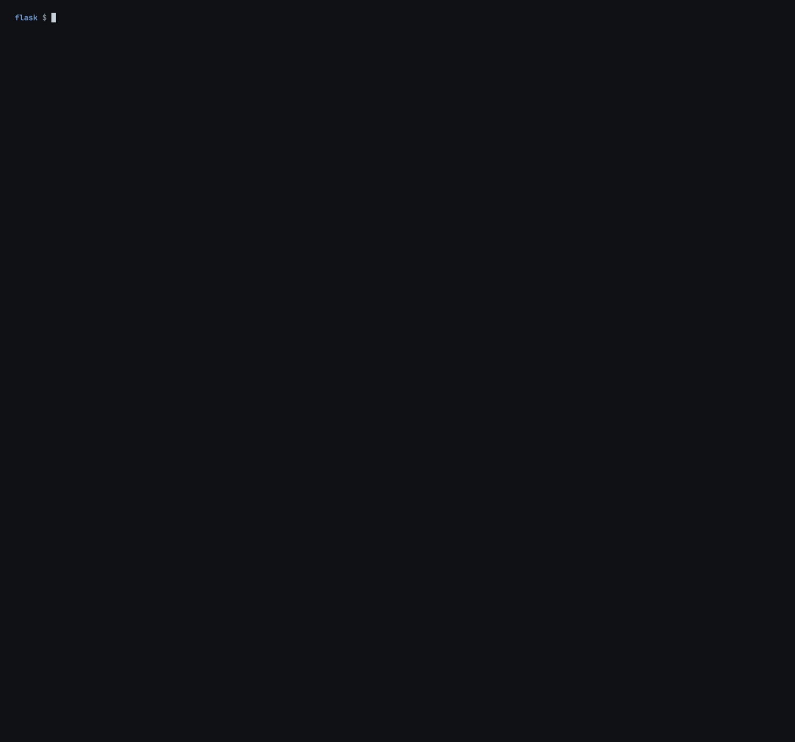

# whyl

**Know why every line your agents wrote is there.** Point whyl at a line and it shows which agent wrote it, what you asked for, what the agent was thinking just before, the edit itself, and how it checked its work.



Works with **Claude Code**, **Codex** and **opencode**. Local-first: one SQLite file on your machine, no accounts, no runtime dependencies. Get explanations of code written by your agent without any external keys or accounts.

## Why is this line here?

Your agents keep a record of everything they do: your prompt, their reasoning, every command and edit. whyl reads those records and ties each line of your code to the turn that wrote it, so you can ask any line why it exists, whichever agent wrote it.

```text
$ whyl blame src/flask/config.py:381
src/flask/config.py:381
                key: "*****" if any(m in key.upper() for m in secret_markers) else value

written by opencode · session ses_ed0360a0effe6ybNqsaqwbnlTj · turn 1 · 2026-10-12 16:35:39 IST · observed by whyl

YOU ASKED
  "Printing app.config shows SECRET_KEY and other secrets in plain text, so they end up in logs and
  tracebacks. Make Config.__repr__ in src/flask/config.py mask values whose keys look secret
  (SECRET, PASSWORD, TOKEN, KEY). Add a test and run .venv/bin/pytest tests/test_config.py"

WHY THIS CHANGE  what the record shows just before it
  thought  16:35:35  Let me implement `__repr__` masking. Keys whose names contain SECRET, PASSWORD,
                     TOKEN, KEY (case-insensitive presumably). Let me use a set of substrings.
                     …

THE CHANGE  16:35:39  src/flask/config.py +9 −1
  │      def __repr__(self) -> str:
  │ -        return f"<{type(self).__name__} {dict.__repr__(self)}>"
  │ +        """Show the config as a dict, but mask the values of keys that
  │ +        look like secrets so they don't leak into logs or tracebacks.
  │ +        """
  │ +        secret_markers = ("SECRET", "PASSWORD", "TOKEN", "KEY")
  │ +        masked = {
  │ +            key: "*****" if any(m in key.upper() for m in secret_markers) else value   ← this line
  │ +            for key, value in self.items()
  │ +        }
  │ +        return f"<{type(self).__name__} {masked!r}>"
  Then, 7s later: ✓ .venv/bin/pytest tests/test_config.py -q  → 23 passed

WORKED  for 25s · 11 steps · src/flask/config.py +9 −1 · tests/test_config.py +18 −0 · tests ✓
  16:35:33  read     config.py
  16:35:33  read     test_config.py
▶ 16:35:39  edit     src/flask/config.py +9 −1   ← wrote this line
  16:35:42  edit     tests/test_config.py +18 −0
  16:35:45  thinking Wait, TEST_KEY contains KEY so it would be masked too. My assertion `"TEST_KEY…
  16:35:46  test     ✓ .venv/bin/pytest tests/test_config.py -q  → 23 passed
  …
```

Everything above comes from the agent's own record. whyl shows the order in which things happened, not proof of cause, and says so.

## Install

Requires [uv](https://docs.astral.sh/uv/) and Python 3.9+.

```sh
uv tool install git+https://github.com/arjunkapoor19/whyl
whyl setup     # one time setup
```

Then use your agents exactly as before. whyl picks up new sessions on its own.

## What you get

**`whyl blame FILE`**: who wrote every line, when several agents (and you) share a file.

```text
$ whyl blame shop.py
author   session turn when               #  code
                                         7  def apply_discount(price, percent):
codex    39de3d  t1   Oct 04 '26 18:52   8      return price * (1 - percent / 100)
…
opencode 6T6Mlw  t2   Oct 11 '26 00:15  17  def mean(prices):
codex    39de3d  t2   Oct 04 '26 18:53  18      if not prices:
codex    39de3d  t2   Oct 04 '26 18:53  19          return 0.0
…
claude   f510a2  t1   Oct 07 '26 15:13  46  def multiply_arrays(a, b):
claude   f510a2  t1   Oct 07 '26 15:13  47      if len(a) != len(b):
claude   f510a2  t1   Oct 07 '26 15:13  48          raise ValueError("arrays must have the same length")
claude   f510a2  t1   Oct 07 '26 15:13  49      return [x * y for x, y in zip(a, b)]

19 pre-existing · 18 codex · 14 claude · 8 opencode · 4 untracked
```

**`whyl blame FILE:LINE`**: the story of the turn that wrote that line, as shown above. What you asked, why the change was made as far as the record shows, the diff with the line marked, the test runs around it, every step of the turn and what the agent concluded. Sub-agent hand-offs are followed back to the prompt that started them.

**`whyl view [FILE[:LINE]]`**: the same history in your browser. Each file is shown with who wrote every block; click any line for its story. It updates live while an agent works. `j`/`k` move between lines, `⌘K` finds any file or session. The page is served from 127.0.0.1 only, and it's prebuilt, so you don't need Node.


**`whyl explain FILE:LINE`**: a plain-language summary of a turn, written by an agent CLI you already have (`claude`, `codex` or `opencode`, run headless with no tools). A session goes to its own agent's CLI, so your code reaches no provider that hadn't already seen it. Each turn is summarized once and kept, nothing is summarized unless you ask, and every summary is labelled as AI-generated, with the model that wrote it.

**`whyl log [SESSION]`**: every session, or one session's timeline.

## Supported agents

| Agent | History read from | Shell edits (`sed -i`, `echo >>`) |
|---|---|---|
| Claude Code | `~/.claude/projects` transcripts | with `whyl setup` (hooks in `~/.claude/settings.json`) |
| Codex | `~/.codex/sessions` logs, or the optional [recorder](docs/recorder.md) | with `whyl setup` (hooks in `~/.codex/hooks.json`) |
| opencode | its SQLite database, read-only | with `whyl setup` (plugin in `~/.config/opencode/plugin/whyl.js`) |

Agents don't report edits they make through the shell. `whyl setup` adds small hooks that snapshot the project before and after each tool call (about 0.1 s each), so every change is credited to the call that made it. Edits made between tool calls are labelled `you`. Your settings are backed up as `*.whyl.bak`, and `whyl setup --remove` takes the hooks out again. Without setup, whyl still works from the agents' logs alone.

Adding an agent means writing one adapter into an agent-agnostic event model; see [docs/event-model.md](docs/event-model.md).

## Local and private

- Everything stays on your machine: the database is `~/.whyl/history.db` (override with `--db` or `$WHYL_DB`), and snapshots of text files up to 1 MB live next to it in `~/.whyl/objects`.
- whyl only reads your agents' history. It keeps synced sessions even after an agent deletes its own (Claude Code removes transcripts after about 30 days).
- Nothing leaves your machine unless you run `whyl explain`, and then only through an agent CLI you already use.
- Blame aligns everything with the file on disk, so a line nothing recorded is reported as untracked, never misattributed.

## Roadmap

- **Behavioral diffs:** compare how agents behave across runs, models and prompts (steps, tests run, files touched, tokens, retries).
- Sub-agent transcripts for Claude Code, and OpenTelemetry ingest for agents beyond coding.

## Docs

- [docs/event-model.md](docs/event-model.md): the canonical event model, each agent's mapping, and how blame works
- [docs/development.md](docs/development.md): running the tests, the code layout, and working on the viewer

## License

[MIT](LICENSE)
